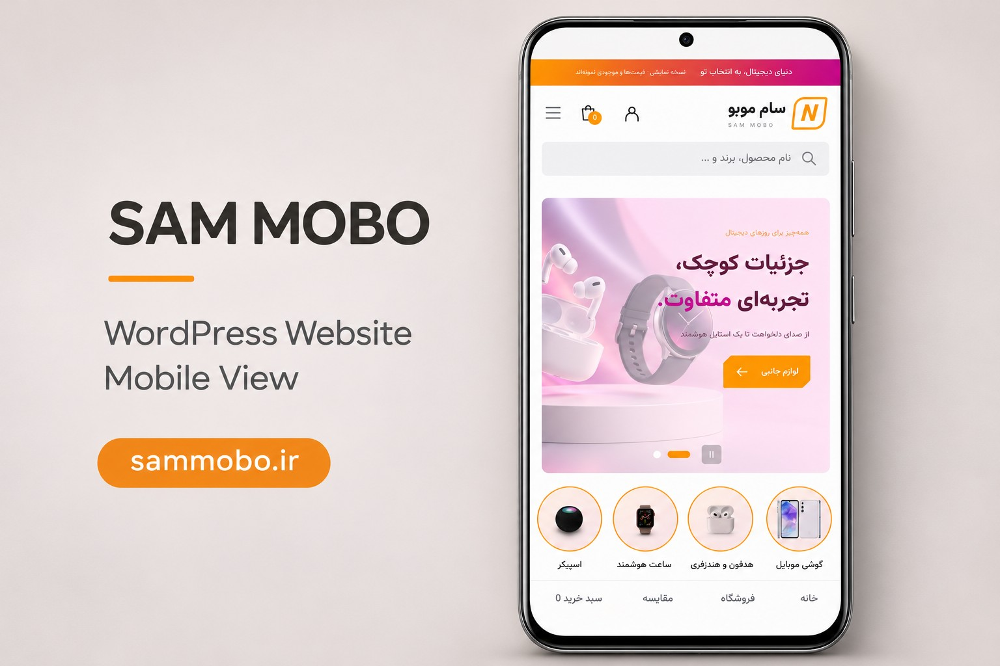

**آدرس پروژه: [sammobo.ir](https://sammobo.ir)**

# سام موبو | فروشگاه وردپرسی موبایل و لوازم جانبی

نمونه‌کار راه‌اندازی و شخصی‌سازی فروشگاه اینترنتی با **WordPress و WooCommerce**، همراه با انتشار روی هاست و دامنه.

## تصاویر پروژه

### نمای دسکتاپ

### نمای موبایل

تصاویر بالا، ماکاپ‌های ارائه نمونه‌کار هستند که بر اساس اسکرین‌شات‌های سایت آماده شده‌اند.

## امکانات و بخش‌های فروشگاه

- نمایش سازگار با موبایل و دسکتاپ و منوی دسترسی سریع در نسخه موبایل
- جست‌وجوی محصولات و دسته‌بندی گوشی، هدفون، ساعت هوشمند و لوازم جانبی
- مقایسه محصولات و فهرست علاقه‌مندی‌ها
- نمایش مشخصات اولیه، گزینه‌های رنگ و ظرفیت محصولات
- نمایش قیمت، درصد تخفیف و قیمت قبل و بعد از تخفیف
- سبد خرید و بخش ورود و ثبت‌نام کاربران
- اسلایدر معرفی محصولات، بنرهای دسته‌بندی و محصولات منتخب
- بخش مجله و سؤالات متداول
- مدیریت محصولات، قیمت‌ها، موجودی و سفارش‌ها از پنل وردپرس و ووکامرس

## نقش من

نصب و پیکربندی وردپرس، تنظیم قالب و افزونه‌ها، شخصی‌سازی ظاهر و چیدمان صفحات، آماده‌سازی محتوای نمونه و راه‌اندازی سایت روی هاست و دامنه.

## فناوری‌ها

WordPress · WooCommerce · مدیریت هاست و دامنه · رابط فارسی و راست‌به‌چپ

## محدوده این نمونه‌کار

این پوشه برای معرفی پروژه و نمایش تصاویر آن است؛ فایل‌های نصب وردپرس، قالب‌ها، افزونه‌ها، اطلاعات ورود و داده‌های مشتری در آن منتشر نشده‌اند. وجود بخش سبد خرید یا سفارش در رابط، به‌تنهایی تأیید پرداخت عملیاتی نیست. در تصاویر، قیمت‌ها و موجودی‌ها نمونه‌اند.

---

## English overview

**Sam Mobo** is a Persian WordPress / WooCommerce mobile-phone and accessories storefront. My role covers WordPress setup, theme and plugin configuration, page customization, sample content preparation, and publishing on hosting with a custom domain.

The storefront presents responsive desktop/mobile layouts, search, product categories, comparison and wishlist controls, product options, discount displays, cart/account sections, promotional banners and editorial sections. This is a portfolio showcase with presentation mockups, not a source-code release or a verification of production checkout.

[Visit the website](https://sammobo.ir) · [GitHub profile](https://github.com/arman-031)
